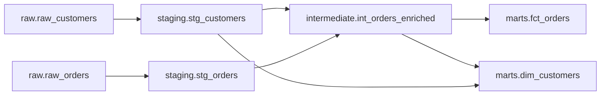

# Data Platform Starter

A tested order fact and customer dimension that keeps status changes, refunds, and non-buyers on the same reporting base.

**Business problem:** Teams currently rebuild order and customer reports by hand from separate extracts. Status updates, cancellations, and partial refunds cause double-counting or missing records.

**What this shows:** Staging → intermediate → marts layering, an incremental fact with a late-arriving data lookback, a written revenue rule enforced by tests, and a customer dimension that includes non-buyers.

The dbt project name is `data_platform_starter`. It runs on DuckDB. Seeds stand in for the store extract: 15 customers and 36 USD orders. After `dbt build`, `marts.fct_orders` has 36 rows and `marts.dim_customers` has 15, including Theo Berg (`C1015`) with `has_ordered = false`.

## Architecture



| Layer | Relation | Materialization | Job |
| --- | --- | --- | --- |
| Raw | `raw_customers`, `raw_orders` | seed | Land the extract. No business rules |
| Staging | `stg_customers`, `stg_orders` | view | Rename, cast, standardize |
| Intermediate | `int_orders_enriched` | view | Join customer context and derive amounts |
| Marts | `fct_orders` | incremental merge | One row per order |
| Marts | `dim_customers` | table | One row per customer, including non-buyers |

`dim_customers` aggregates `int_orders_enriched`, the full population. Lifetime totals stay complete because they do not read the incremental fact's lookback window.

## Setup

Python 3.10 or newer. `requirements.txt` installs `dbt-core` 1.11.x and `dbt-duckdb` 1.11.x. The adapter brings a DuckDB build that supports `MERGE` (DuckDB 1.4.0 or newer).

PowerShell, from the project directory:

```powershell
python -m venv .venv
.\.venv\Scripts\Activate.ps1
python -m pip install -r requirements.txt
Copy-Item profiles.yml.example profiles.yml
$env:DBT_PROFILES_DIR = (Get-Location).Path
```

bash:

```bash
python -m venv .venv
source .venv/bin/activate
python -m pip install -r requirements.txt
cp profiles.yml.example profiles.yml
export DBT_PROFILES_DIR="$PWD"
```

`profiles.yml` is gitignored. The `dev` target writes `dev.duckdb` next to that file. The `ci` target uses an in-memory database. The profile sets `threads: 1` because a local DuckDB file has one writer.

On Windows on ARM, `dbt-extractor` 0.6.0 publishes an x64 wheel only. Use an x64 interpreter or `pip` will try to compile it:

```powershell
uv python install cpython-3.12.13-windows-x86_64-none
uv venv --python cpython-3.12.13-windows-x86_64-none .venv
.\.venv\Scripts\Activate.ps1
uv pip install -r requirements.txt
```

## Run

```powershell
dbt seed
dbt run
dbt test
```

`dbt build` runs the same three steps in dependency order.

```powershell
dbt show --inline "select order_status, count(*) as orders, sum(recognized_revenue_amount) as recognized_revenue from marts.fct_orders group by 1 order by 1" --limit 10
```

`analyses/revenue_by_country.sql` is a country slice. Compile it with `dbt compile --select revenue_by_country`. Analyses are not built by `dbt run`.

Recognized revenue is zero when the order is cancelled. Otherwise it is order total minus the refund on the row. Delivered orders in the sample sum to 2,244.10. Three returned orders contribute 17.38 after refunds. Three cancelled orders contribute 0.

## Design decisions

### Incremental orders

`marts.fct_orders` is incremental:

| Config | Value |
| --- | --- |
| Strategy | `merge` |
| Key | `order_id` |
| Lookback | `orders_lookback_days`, default `2` |
| Schema change | `sync_all_columns` |

The first run loads every order because the table does not exist yet. Later runs select source rows with `updated_at` inside two days of `max(updated_at)` already stored, then merge them. Matched orders are updated. New `order_id` values are inserted. Rows outside the window keep their current values, including `dbt_updated_at`.

Merge is the right write for this grain. Status and refund amount change on an existing order, and the published table has to keep one row per `order_id`. A strict `updated_at > max(updated_at)` filter misses a correction whose timestamp is already behind the watermark. Two days covers a missed daily run plus a day of late extracts.

`O10021` was placed on 20 October 2026 and marked shipped on 16 November. That `updated_at` sits inside the window of the sample watermark, `O10036` at `2026-11-17 18:40:00`, so each incremental run re-merges it. `O10033`, last touched on 14 November, stays outside the window and is left as stored.

Widen the window for a recent backfill, or full-refresh when the measure itself changes:

```powershell
dbt run --select fct_orders --vars "{orders_lookback_days: 7}"
dbt run --select fct_orders --full-refresh
```

To see a merge update, change `O10035` in `seeds/raw_orders.csv` from `placed` to `cancelled`. Its `updated_at` (`2026-11-17 10:45:00`) is already inside the window. Then:

```powershell
dbt seed
dbt run --select fct_orders
```

`fct_orders` still has one row for `O10035`, now cancelled, with recognized revenue of 0.

### Other modeling choices

- **Narrow layers.** Staging does not join. Intermediate holds the join and the amount logic. Marts publish grain.
- **Layer schema names.** `macros/generate_schema_name.sql` writes `raw`, `staging`, `intermediate`, and `marts` directly. The profile schema `main` is only the fallback.
- **Natural keys.** `order_id` and `customer_id` come from the store and are unique in the extract.
- **Cancellations and returns stay on the fact.** Consumers filter with `is_cancelled`, `is_returned`, and `recognized_revenue_amount`.
- **Refunds are an amount.** `O10009` is a partial refund: total 37.38, refund 20.00, recognized 17.38. `O10003` and `O10016` are full refunds.
- **USD only.** An `accepted_values` test holds the currency until a rate table exists. Sums are valid because every amount shares one currency.
- **Customer country on the fact is the current customer record.** There is no address history in the extract.
- **Tests are the metric contract.** Keys are `unique` and `not_null`. Status, payment method, and currency are `accepted_values`. `tests/assert_order_amounts_are_consistent.sql` checks the revenue identity.
- **Descriptions are stored on the relations.** `persist_docs` writes them as DuckDB comments.

## Production considerations

- **Replace the seeds with a landing source.** Keep the staging-to-mart path and the tests. Map store columns in staging.
- **Treat the revenue rule as an operating snapshot.** It includes in-flight `paid` and `shipped` orders and nets refunds already on the row. It is the number for the weekly pack, not a GAAP subledger. Change it in `int_orders_enriched` and let the singular test fail until both teams accept the new rule.
- **Size the lookback to the source, then document what it will miss.** Updates older than `orders_lookback_days` relative to the watermark need a wider variable or `--full-refresh`. A source that backdates `updated_at` will be invisible to the incremental filter.
- **Keep lifetime metrics off the incremental fact.** Any new customer aggregate should read `int_orders_enriched` or a full upstream model. Reading `fct_orders` during an incremental run undercounts history.
- **Revisit dev schema isolation.** Direct layer names are right for one local file. On a shared warehouse, prefix custom schemas with the target schema so developers do not overwrite each other.
- **Raise threads on a real warehouse.** `threads: 1` is the safe setting for a single DuckDB file. A warehouse connection can run models concurrently.
- **Add the pieces this extract does not have before calling the mart financial.** A rate table for mixed currency, and a slowly changing customer dimension if country or segment must be as-of the order date.
- **Run `dbt build` in CI against the in-memory `ci` target** so a broken key or a broken revenue identity fails the change.

## How this is used in advisory work

Use the project to settle the metric contract before a warehouse migration. Agree the pack with finance and operations: in-flight orders, cancellation rate, full versus partial refunds, recognized revenue, and accounts that never ordered. Lock that rule in `int_orders_enriched`, load a short client extract in place of the seeds, and walk the exceptions. The numbered engagement steps are in [docs/business-context.md](docs/business-context.md).

## License

MIT. See [LICENSE](LICENSE).

## Author

Amritap Datta
